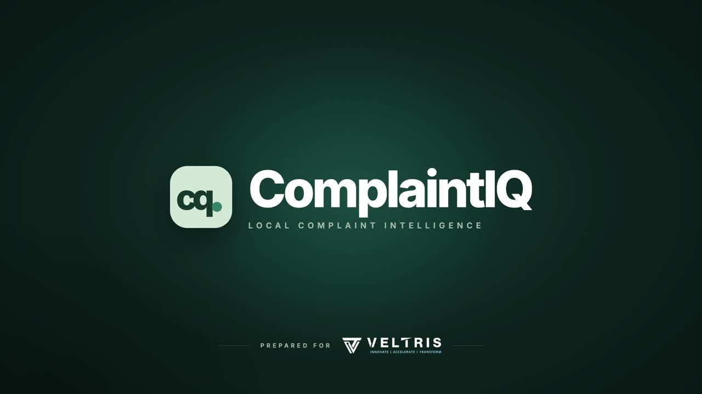
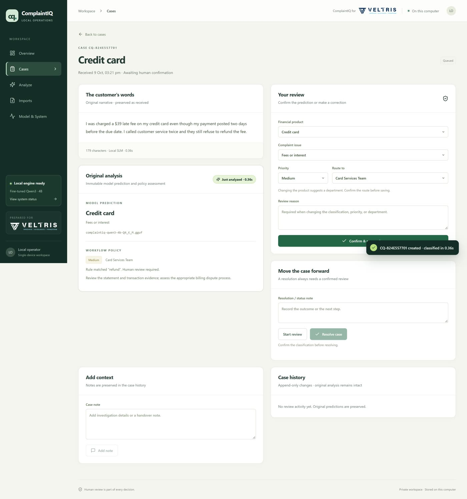

# ComplaintIQ

**Private, accountable triage of financial complaints, running entirely on your Mac.**

ComplaintIQ reads a customer complaint, classifies its financial product and issue with a
fine-tuned small language model (**Qwen3-4B**, QLoRA, served locally by llama.cpp), applies
readable priority and routing rules, and puts every case in front of a human reviewer.
No cloud service, no external API: complaints, predictions and review history stay on the machine.

[](docs/media/ComplaintIQ_Demo.mp4)

▶ **[Watch the 96-second demo video](docs/media/ComplaintIQ_Demo.mp4)** (opens GitHub's video player; use *Download raw file* if it does not play inline).



## What it does

- **Classify:** product and issue for three CFPB product families (credit card, credit reporting, checking/savings) across nine product/issue pairs. Decoding is constrained to valid pairs, so the model cannot invent a label.
- **Scope gate:** complaints about other products (mortgages, student loans, unrelated text) go straight to human review instead of being forced into a category.
- **Workflow rules:** priority and routing come from explicit, readable rules that show which phrase matched. They are policies, not model output.
- **Human review:** confirm or correct each case (corrections need a reason), add notes, start review, resolve or reopen. Every change is kept in an append-only history, and the original prediction is never overwritten.
- **Batch imports:** upload a CSV of up to 100 complaints. A durable queue saves each row as it is processed and survives restarts.
- **Operations:** overview dashboard, searchable case list, CSV export of reviewed labels, and daily plus manual database backups with a restore tool.

## Model results

| Evaluation | Result |
|---|---|
| 153 reserved test complaints, GGUF in the app ([`artifacts/qwen3_evaluation.json`](artifacts/qwen3_evaluation.json)) | product **90.85%**, joint product/issue **58.82%**, mean latency **204 ms** on an RTX 4070 (about 2 s on an M1 Mac) |
| 3,000-row 10-class test set, Feb–Jul 2026 ([`training/results/…/results.md`](training/results/qwen3-4b-main/eval/results.md)) | accuracy **64.50%**, macro F1 **64.95%**, product **90.27%**, 0 invalid replies |
| Earlier Qwen2.5-1.5B model / TF-IDF baseline, same 153 complaints | product 88.89% / 88.24%, joint 54.25% / 55.56% |

The model was fine-tuned from Qwen3-4B-Instruct-2507 on 70,162 real CFPB complaints (950 QLoRA
steps, about 2 hours on one RTX 4070) and exported to a 2.5 GB Q4_K_M GGUF. Q4_K_M quantization
costs some accuracy (59.7% vs 64.7% for the unquantized adapter on 300 test rows). See
[`training/`](training/README.md) for how it was trained and [`report/`](report/) for the full project report.

## Quick start (macOS, Apple Silicon)

### Requirements

- macOS on Apple Silicon (tested on an M1 with 8 GB RAM)
- Python 3.12, Node.js 22.12+ and [Homebrew](https://brew.sh)
- About 3 GB of free disk space for the model

### 1. Clone and install

```sh
git clone https://github.com/Shivasai132678/complaintiq-slm.git
cd complaintiq-slm

python3.12 -m venv .venv
.venv/bin/python -m pip install -r requirements.txt

cd frontend && npm ci && npm run build && cd ..
```

### 2a. Run with the fine-tuned model (full experience)

```sh
brew install llama.cpp
# Place the GGUF at models/complaintiq-qwen3-4b-Q4_K_M.gguf (2.5 GB; not stored in Git, see below)
sh run_pilot.sh
```

`run_pilot.sh` starts `llama-server` (Metal) on port 8504 and the app on port 8501, waits until both
answer, and stops both on Ctrl+C. Logs go to `data/logs/`.

### 2b. Run without the model (baseline classifier)

```sh
sh run_demo.sh
```

This uses the built-in TF-IDF baseline. It needs no GGUF and no llama.cpp, and it is the quickest way to try the workflow.

### 3. Open the app

Go to **http://127.0.0.1:8501**. To fill an empty dashboard with clearly labeled public demo complaints, run:

```sh
.venv/bin/python -m scripts.seed_demo
```

### About the model file

The fine-tuned GGUF (`complaintiq-qwen3-4b-Q4_K_M.gguf`, SHA-256 `9a810438c1acac3094aae0bf5c0f84a31a190c844020a501579b19f418172211`)
is 2.5 GB, which is over GitHub's file and release-asset limits, so it is not in this repository.
Ask the author for a copy, or reproduce it with [`training/`](training/README.md). Any compatible GGUF
can be used with `COMPLAINTIQ_MODEL_PATH=/path/to/model.gguf sh run_pilot.sh`.

## Project structure

```text
complaintiq/        FastAPI app: classifiers, scope gate, triage rules, queue, SQLite storage
frontend/           React + TypeScript (Vite) interface, served by the API in production
scripts/            Launcher, evaluation, data preparation, demo seeding, backup restore
training/           Qwen3-4B QLoRA training, evaluation and GGUF export code + published results
data/               Baseline splits, fine-tuning dataset and scope-gate data (public CFPB records)
artifacts/          Evaluation results; video/motion-source holds the demo video source (Remotion)
docs/               Pilot guide, model and dataset notes, demo walkthrough, planning history
report/             Project report (PDF/HTML) and the script that builds it
tests/              pytest suite (API, storage, queue, scope gate, training helpers, launcher)
```

## Development

```sh
.venv/bin/python -m pip install -r requirements-dev.txt
.venv/bin/python -m pytest --cov=complaintiq
.venv/bin/python -m ruff check complaintiq scripts tests
.venv/bin/python -m mypy complaintiq scripts
cd frontend && npm test && npm run build
```

For frontend work, run a separate API on port 8502 with its own database:

```sh
COMPLAINTIQ_DB_PATH=/tmp/complaintiq-dev.sqlite3 .venv/bin/python -m uvicorn complaintiq.api:app --host 127.0.0.1 --port 8502
cd frontend && npm run dev   # Vite proxies /api to port 8502
```

`requirements-lock.txt` pins the full verified environment.

### Configuration

| Variable | Default | Purpose |
|---|---|---|
| `COMPLAINTIQ_MODEL_PATH` | `models/complaintiq-qwen3-4b-Q4_K_M.gguf` | GGUF used by `run_pilot.sh` |
| `COMPLAINTIQ_LLAMA_SERVER` | `llama-server` on PATH, then Homebrew | llama.cpp server binary |
| `COMPLAINTIQ_DB_PATH` | `data/complaintiq.sqlite3` | Case database (backups go next to it) |
| `COMPLAINTIQ_BACKEND` | `slm` in `run_pilot.sh`, `baseline` in `run_demo.sh` | Classifier engine |
| `COMPLAINTIQ_OPEN_BROWSER` | unset | Set to `1` to open the browser when the app is ready |

### Rebuilding the demo video

The video is a [Remotion](https://www.remotion.dev) project in `artifacts/video/motion-source`, with
synthesized music (`audio/music.py`) and a neural voice-over (`audio/vo.py`, Microsoft neural
voice via `edge-tts`, which needs internet and sends the narration text to Microsoft's speech service).

```sh
.venv/bin/python -m pip install -r artifacts/video/motion-source/requirements.txt
.venv/bin/python artifacts/video/motion-source/audio/music.py
.venv/bin/python artifacts/video/motion-source/audio/vo.py
cd artifacts/video/motion-source && npm ci && npm run render
```

## Limits

- One local operator on one Mac. There are no accounts, and both services bind to `127.0.0.1` only, so do not expose them publicly.
- Priority, routing and suggested actions are demonstration rules, not legal or regulatory assessments.
- Accuracy figures come from public CFPB samples and do not establish production suitability. Joint product/issue accuracy is modest, which is why every case goes through human review.
- Backups contain raw complaint text and are not encrypted by the app.

More detail: [local pilot guide](docs/LOCAL_PILOT.md) · [demo walkthrough](docs/DEMO_WALKTHROUGH.md) · [fine-tuning dataset](docs/FINETUNING_DATASET.md).

## Attribution

Adapted from the MIT-licensed [complaint-routing-intelligence](https://github.com/MohammedHssan11/complaint-routing-intelligence)
project. See [THIRD_PARTY_NOTICES.md](THIRD_PARTY_NOTICES.md). Upstream pickle files and claimed benchmark figures are not used.
Complaint data is from the public [CFPB Consumer Complaint Database](https://www.consumerfinance.gov/data-research/consumer-complaints/).
